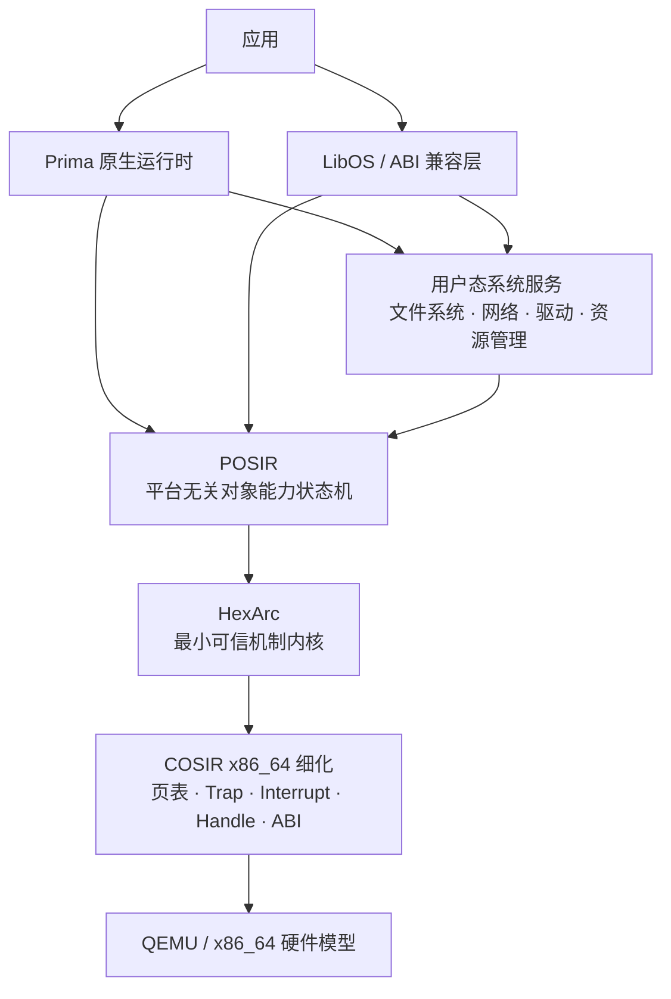

# Prima OS：架构与研究白皮书

> 文档类型：决策型架构白皮书
>
> 状态：研究设计阶段
>
> 首个实现目标：QEMU x86_64 原型
>
> 更新日期：2026-08-26
>
> 精确语义规范：[[COSIR 原语规范]]

## 摘要

Prima OS 是一个**元操作系统研究项目**。它尝试把传统操作系统同时承担的机制、策略与应用兼容语义拆开：

- HexArc 内核只保留隔离、授权、执行、内存映射、通信、命名、时间和自举所需的通用机制；
- POSIR 用平台无关的对象能力状态机描述这些机制；
- COSIR 把抽象状态机细化为特定硬件上的页表、陷阱、中断、句柄和 ABI；
- LibOS 与用户态服务构造 POSIX、Linux 或其他操作系统语义；
- Prima 原生运行时为新应用提供不绑定既有 OS ABI 的稳定接口。

项目的长期愿景是：同一最小机制层可以支撑多个互不信任的 LibOS，并让操作系统兼容语义成为可替换、可组合、可审计的用户态构件。

这仍是**研究假设**，不是已经完成的兼容性或安全性结论。当前成果主要是抽象语义与架构边界；尚无可据此宣称安全、兼容或高性能的完整内核实现。

## 1. 文档职责与状态标签

本文负责回答：

- Prima OS 要解决什么问题；
- 为什么采用对象能力、最小内核和 LibOS；
- 各层如何协作；
- 通用兼容性主张怎样被验证或推翻；
- 首个 QEMU x86_64 原型如何分阶段落地。

本文不复制每项原语的参数、前置条件和状态迁移。精确语义以 [[COSIR 原语规范]] 为唯一权威来源。该文件沿用历史名称，其中平台无关部分属于 HexArc / POSIR 抽象语义，硬件实现部分属于 COSIR 细化工作。

本文使用三种状态标签：

| 标签       | 含义                             |
| -------- | ------------------------------ |
| **已定义**  | 已在当前架构或抽象规范中给出明确语义，但不代表已经实现或证明 |
| **待验证**  | 有可执行的验证方法，但尚无足够证据支持            |
| **长期目标** | 用于指导研究方向，不应当作近期承诺              |

除非明确写为“已证明”或“已通过测试”，否则本文中的安全性、兼容性和性能表述都不代表完成状态。

## 2. 问题陈述

传统通用操作系统通常把以下内容固化在同一个内核及 ABI 中：

- 地址空间、线程和调度机制；
- 文件、目录、socket、pipe、signal 等对象语义；
- 全局命名、权限和身份模型；
- 设备、驱动与 I/O 协议；
- 面向特定应用生态的系统调用 ABI。

这种结构非常成功，但也带来三个研究问题：

1. **语义绑定：** 应用兼容性、资源机制和安全策略难以独立替换；
2. **共存成本：** 多种 OS personality 往往需要虚拟机、容器或大规模兼容层；
3. **验证边界：** 内核同时理解大量高级对象，扩大了需要信任和验证的语义范围。

Prima OS 的核心命题不是“删除操作系统”，而是把操作系统拆成不同可信级别的层：

- 内核实现不可绕过的机制与隔离；
- LibOS 实现面向应用的 OS personality；
- 用户态服务实现文件系统、网络、驱动和策略；
- 运行时为原生应用提供稳定编程接口。

“操作系统退化为库”在本文中是架构方向，不是字面上把所有内核职责移入普通函数库。页表切换、特权级、陷阱入口和硬件隔离仍必须由受保护机制实现。

## 3. 可证伪的研究假设

### H1 — 机制表达力

**假设：** 一组有限、正交且不绑定特定 OS personality 的机制，可以组合出代表性操作系统 API 的可观察语义。

这不能通过“任何调用都编码成一条通用消息”来空洞地成立。一个 API 映射只有同时满足以下条件才算有效证据：

1. 不向 HexArc / COSIR 加入该 OS 专属对象或分支；
2. 映射使用稳定的通用对象、Capability、用户态服务和协议；
3. 在声明的兼容 profile 内保留返回值、错误、阻塞、顺序、并发和权限语义；
4. 明确记录无法保留的语义差异；
5. 不以“一项 API 增加一项新原语”的方式无限扩张机制集；
6. 时间、内存和上下文切换成本可以测量。

**可能反例：** 某项基础 OS 语义只有在内核理解该 OS 的专属对象后才能正确实现，或通用分解导致无法接受的语义偏差。

### H2 — 多 LibOS 共存

**假设：** 多个互不信任的 LibOS 可以共享同一个 HexArc 内核，并通过对象能力边界限制彼此影响。

**验证条件：**

- 每个 LibOS 只持有其服务、Task、Segment、Namespace 和设备的必要 Capability；
- 不存在隐式全局根、全局文件系统或可伪造句柄；
- 一个 LibOS 的失败不要求另一个 LibOS 信任其内部策略；
- 跨 LibOS 协作必须经过显式委托、共享 Segment 或消息协议。

**可能反例：** 隔离必须依赖内核识别具体 LibOS 类型，或一个 LibOS 能通过未授权内核状态直接修改另一个 LibOS 的局部状态。

### H3 — 小型可信机制层

**假设：** 把 OS personality 移出内核后，剩余抽象状态机和硬件细化足够小且规则化，可以分别验证不变量和细化关系。

**验证条件：**

- 原语保持统一的对象、Capability 与失败原子性模型；
- 关键安全性质可由全局不变量推出；
- COSIR 实现能够给出到 POSIR 状态的 refinement relation；
- 新增硬件机制不会迫使抽象层引入大量平台特例；
- 可信机制层规模具有可证伪的量化指标（可信代码行占比及其增长趋势），并随实现阶段记录实测值。

**可能反例：** 驱动、异常、资源控制或兼容需求使可信机制层重新膨胀为传统宏内核规模，或抽象与实现之间无法建立可维护的对应。

### H4 — 兼容性与性能可以渐进获得

**假设：** Prima 可以先提供原生服务，再逐步获得 POSIX 源码兼容和选定 Linux 二进制兼容，而不牺牲内核的 OS 中立性。

**可能反例：** 兼容层必须绕过 Capability 边界、把 Linux 专属状态移入内核，或关键工作负载的转换成本无法通过批处理、共享内存和协议优化控制。

这些假设彼此独立。证明抽象状态机安全不会自动证明 API 完备性、二进制兼容或可接受性能。

## 4. 分层架构



### 4.1 应用层

应用分为两类：

- **Prima 原生应用：** 调用统一运行时，不依赖某一传统 OS 的 syscall ABI；
- **兼容应用：** 通过 POSIX 源码适配层或 Linux ABI LibOS 运行。

两类应用最终都只能通过当前 Task 持有的 Capability 影响系统对象。

### 4.2 Prima 原生运行时

统一运行时是面向新应用的稳定 API，不是新的特权内核。它计划提供：

- Task 与语言级并发抽象；
- Segment、缓冲区和共享内存管理；
- 消息、异步等待和 Timer；
- Namespace 与服务发现；
- 服务协议、错误类型和生命周期封装；
- 可选的语言运行时适配。

运行时可以在用户态实现调度策略、协程和 I/O reactor，但底层隔离、Task 状态和地址空间修改仍由 HexArc 授权。

### 4.3 LibOS 与兼容层

LibOS 为应用提供某种 OS personality。它负责：

- 进程、线程、文件描述符和 errno 等兼容状态；
- 将 API 或 syscall 翻译为 POSIR 操作和用户态服务协议；
- 维护该 personality 的命名、权限和生命周期规则；
- 明确报告无法精确映射的语义。

LibOS 不是全局唯一组件。不同 Task 或应用域可以绑定不同 LibOS，也可以完全不使用传统 OS 语义。

### 4.4 用户态系统服务

文件系统、网络协议栈、设备驱动、加载器和资源管理器原则上作为用户态服务运行。服务通过 Capability 暴露接口，通过消息或共享 Segment 交换数据。

“用户态服务”不等于“不受保护”。服务仍位于独立 Task 中，只获得完成职责所需的 Capability。

### 4.5 POSIR

POSIR 是平台无关的抽象状态与迁移接口。它描述：

- 存在哪些对象和权限；
- 哪个 Task 持有什么 Capability；
- 一项操作何时成功或失败；
- 成功如何原子修改状态；
- 哪些全局不变量必须始终成立。

POSIR 不描述页表位、寄存器布局、具体 syscall number 或中断控制器。

### 4.6 HexArc

HexArc 是实现 POSIR 可信机制的最小内核。名称来自早期“六原语”构想，但当前设计**不把原语数量当作约束**。如果安全、终止性或硬件细化需要新的正交机制，应通过可证明边界评估，而不是为了保持名称强行隐藏语义。

### 4.7 COSIR

COSIR 是 POSIR 在具体硅基架构上的实现与细化层。首个目标是 QEMU 上的 x86_64。COSIR 至少需要定义：

- 对象 ID 与不可伪造句柄的机器表示；
- 页表、TLB、用户/内核权限和 W^X 策略；
- syscall、异常和中断入口；
- 上下文保存与调度线性化点；
- MMIO、IRQ、DMA 与 IOMMU 的授权；
- 有限整数、资源耗尽和 ABI 错误码；
- 抽象状态与机器状态之间的细化关系。

## 5. 当前机制基线

[[COSIR 原语规范]] 当前定义以下接口类别：

本文按 **12 类 Bootstrap 后常规机制 + 1 个 Bootstrap 初始化迁移** 统计接口类别。§19 总览因此列出 13 项；其中 Bootstrap 是初始 Authority 的唯一来源，不是系统引导完成后的常规可调用操作。H1 中的“12 类”仅指 Bootstrap 后常规机制，不包含该唯一初始化迁移。

| 类别 | 作用 |
|---|---|
| Capability | 派生、权限衰减、显式共享和 token 清理 |
| MemorySegment | 页帧对象、显式地址空间映射与保护变更 |
| Task | 执行单元、生命周期、调度状态与定向 upcall |
| Send | 有授权的消息和 Capability 原子转移 |
| Recv | FIFO 接收与阻塞恢复 |
| WaitObject | 通用等待/唤醒、超时与可警报阻塞 |
| Timer | 单调绝对时间与一次性内核通知 |
| Namespace | 路径化 Capability 存储、解析和挂载 |
| Audit | Capability 派生、移动和对象生命周期溯源 |
| Exception | 异步事件订阅与硬件异常路由（page fault、syscall trap、硬件中断等） |
| Device | MMIO、I/O port、IRQ 和 DMA 的对象能力化封装 |
| Node | 跨节点通信的节点对象（多机分布式场景） |
| Bootstrap | 唯一的初始 Authority 来源 |

这张表是阅读导航，不构成“必须恰好这些类别”的承诺。判断是否加入新机制时应回答：

1. 它是否无法由现有机制在不破坏安全或语义的前提下表达；
2. 它是否属于所有上层模型都需要的机制，而不是某个 OS personality 的策略；
3. 它能否形成清晰、独立且可验证的状态边界；
4. 它是否扩大可信计算基，以及扩大是否必要。

## 6. 对象能力与安全模型

### 6.1 Authority 的表示

Capability 是内核分配、用户态不可伪造的 token。它至少关联：

- 目标对象；
- 权限集合；
- 派生父项；
- 当前唯一位置。

一个 Capability token 在任意时刻至多位于一个 Task、Message 或 Namespace。共享 Authority 不复制同一个 token，而是显式派生新的子 Capability；子权限不得超过父权限。

### 6.2 Authority 的流动

允许的主要流动包括：

- Task 之间随消息移动；
- Task 与 Namespace 之间 bind / unbind；
- Namespace resolve 派生新 token；
- Task 创建时注入初始 Capability；
- 对象销毁后保留为不可授权的 stale token，以维持审计链。

第一版不提供派生树的选择性撤销。丢弃父 Capability 不撤销已经派生的子项；销毁目标对象会使所有相关 token 失去授权能力。

> **实现注记（2026-08）：撤销域定义与现状。**
>
> 第一版不提供派生树的选择性撤销。当前探索阶段的真实内核已在 Bootstrap 状态中以细化形式先行落地选择性撤销——`revoke_capability` 将撤销传播到完整派生子树，不引入对 POSIR 可见的一等新原语，因此不构成 H1/H3 反例。它超前于本小节与 §8 的"第一版只支持 drop 与对象销毁"范围声明，故此处给出该撤销操作的撤销域定义（与 [[COSIR 原语规范]] §4.7 相对应），并如实标注当前实现边界。
>
> **撤销域定义（与 `cap_drop` 正交的选择性撤销）：**
>
> 1. **撤销对象与域**：`revoke(cap, holder)` 使 `cap` 及其完整派生子树（由 `parent` 指针链可达的所有活动 Capability）同时失效。被撤销 token 进入 `Inactive` 态，不再能被派生、移动、随消息发送或用于任何授权；它们保留在审计链中不可伪造，以维持溯源。
> 2. **派生树一致性**：撤销沿派生方向单调传播——父失效则所有直接/间接子项一并失效；子项失效不影响其父。权限单调性（子 ⊆ 父）保证撤销任何根即可原子地收回其下全部授权，无需逐个子项处理。
> 3. **与 `cap_drop` 正交**：`cap_drop` 只删除持有者手中的单个位置记录，不传播、不清除派生关系；`revoke` 是幂等、含目标的激进收回，两者语义互不替代。`revoke` 不隐含于 `cap_drop`（遵循 §4.7 的约束）。
> 4. **token 中间态**：一个成功的 `revoke` 视为单一原子操作——要么根的整个派生子树全部失效并有完整审计记录，要么（审计容量不足等）全部保持原状，不存在"部分子树已撤销、部分仍活动"的可观察中间态。
> 5. **在途消息与命名空间位置**：撤销域仅覆盖由调用者直接持有的 Capability 及其派生后代。已移入消息（`InMessage`）、命名空间绑定（`InNamespace`）或跨节点在途（`InTransit`）的 Capability **不属于**当前撤销域——它们的收回依赖目标对象销毁或各自的消费路径，留待后续阶段定义。
>
> **当前实现边界：** 宿主 `revoke_capability` 已实现子树传播、审计容量预演与原子提交（SPEC-022/023）；但仅接受 `HeldBy(holder)` 位置的根 Capability（其他位置返回 `HolderMismatch`），派生树失效范围与"在途消息/命名空间不纳入撤销域"是更简单的固定容量表近似，未覆盖并发的撤销/移动竞争与跨节点（`InTransit`）撤销传播。真实并发语义仍待规范后续阶段明确定义。

### 6.3 显式授权通道

抽象模型承认以下跨 Task 通道：

1. 持有 `TaskSend` 后发送消息；
2. 同时持有 Segment 映射权与目标 Task 地址空间管理权后建立共享映射；
3. 通过 Namespace 的授权路径获得 Capability；
4. 使用相应管理或销毁 Capability 修改对象；
5. 读取规范明确暴露的时间与 Audit 信息。

在把调度、时间、全局 ID、资源余量和日志容量排除出观察后，应能够证明其他 Task 的局部状态不会被无授权操作改变。

### 6.4 威胁模型

第一阶段假设：

- 普通应用与 LibOS 可以恶意或出错；
- 用户态不能伪造 Capability、KernelActor 或内核消息来源；
- 内核与 COSIR 细化是待验证的可信基；
- 硬件按照其架构契约执行权限与隔离；
- 启动链、固件和 QEMU 暂时位于外部可信边界。

第一阶段不声称防止：

- 缓存、分支预测、总线竞争和调度时序信道；
- 资源耗尽与拒绝服务；
- Rowhammer、故障注入和恶意硬件；
- 已获授权参与者主动泄露数据；
- 被攻破的内核或启动链。

因此，准确目标是**抽象状态机中的显式授权安全**，不是完全非干扰。

### 6.5 失败语义

所有受保护操作先验证 Actor、对象、Capability、权限、参数和资源，再原子提交。失败操作不得改变抽象状态。

具体 ABI 可以规定稳定的错误优先级，但不能通过“先修改、失败后尽量回滚”来偏离抽象原子性。LibOS 负责把底层错误映射为其 personality 的 errno、异常或状态码。

## 7. 运行时与多 LibOS 模型

### 7.1 应用域

一个应用域由一组 Task、一个或多个 LibOS 服务以及私有或共享 Segment 构成；域内每个 Task 仍持有自己的结构性根 Namespace Capability，这些根可以派生自同一父 Namespace，也可以指向不同的 Namespace 视图。应用域不是新的内核对象；它是用户态资源管理器维护的组合。

应用域和 LibOS 是独立正交的维度：
- **应用域**是 Capability/资源边界——域内的 Task 共享某些 Segment 和 Capability，域间隔离通过不共享 Capability 实现；
- **LibOS** 是语义翻译层——将某种 OS personality 的 API 翻译为 POSIR 原语和服务协议；
- 一个应用域内可以有零个（纯原生应用）、一个或多个（分层翻译）LibOS 实例；
- 一个 LibOS 实现可以被多个应用域独立实例化，每个实例有自己的语义状态（文件描述符表、进程树等）。

这种设计避免内核预设”进程组、容器或虚拟机”的唯一含义。不同管理器可以用相同机制构建不同隔离单元。

### 7.2 LibOS 边界

LibOS 应拆成可独立测试的职责：

- **ABI 前端：** 接收原生 API、POSIX 调用或 Linux syscall；
- **语义状态：** 文件描述符、进程关系、信号状态等；
- **资源适配：** 把兼容对象映射为 Task、Segment、Capability 与服务会话；
- **服务客户端：** 访问文件系统、网络、时钟和设备服务；
- **错误与事件转换：** 保持目标 profile 的可观察行为。

只有与某个应用共享其语义状态的 LibOS 才位于该应用的兼容性可信基中。它不应自动获得其他应用域的 Authority。

### 7.3 跨 LibOS 协作

两个 LibOS 需要共享文件、socket 或内存时，必须通过以下之一显式协作：

- 相互委托服务 Capability；
- 共同访问一个独立服务；
- 派生并传递受限 Segment Capability；
- 在合成 Namespace 中挂载授权入口。

内核不应通过全局对象表替它们自动建立语义关联。

## 8. 兼容性路线

兼容性按三个里程碑递进，不同时承诺所有目标。

### 8.1 阶段一：Prima 原生服务

目标：验证对象能力状态机、服务协议和运行时能否支撑自举系统，而不先背负传统 ABI。

最小工作负载建议包括：

- init 与服务管理；
- 内存与 Task 管理服务；
- Namespace 浏览与服务发现；
- 日志或终端服务；
- Timer 驱动的异步事件循环；
- 一个使用消息与共享 Segment 的原生应用。

该阶段成功只能证明原生模型可用，不能证明 POSIX 或 Linux 兼容。

### 8.2 阶段二：POSIX 源码兼容

目标：让选定的 C/POSIX 程序在重新编译后运行。

必须先冻结一个明确 profile，例如：

- 基础 libc 与进程启动；
- `read/write/open/close`；
- 基础路径与目录操作；
- `mmap` 的有限子集；
- 线程、互斥和条件变量的有限子集；
- 明确列出的时钟与 socket API。

每项 API 都要记录：支持、部分支持、不支持、语义差异和测试证据。不得只以“能够编译”作为兼容完成标准。

本阶段已有一份**候选的逐项规格**：《基础库栈（基座库）技术规格书 v1.1》（`docs/superpowers/specs/2026-10-11-baselib-stack-spec-v1.1.md`，含走查/扫雷记录 `2026-10-11-baselib-stack-walkthrough.md`）。**它是外部候选提案，不是已评审的权威约束**；其假设的内核侧前置 ABI 承诺与号段命名均未裁决（见跟踪文档 BLK-003），分解细节与风险见本文 §15 阶段 5。

### 8.3 阶段三：选定 Linux x86_64 静态 ELF

目标：运行一个明确白名单内、无需修改的 Linux x86_64 静态 ELF 测试集。

该阶段至少需要：

- ELF 加载器和 Linux 初始栈布局；
- syscall trap 到 Linux LibOS 的可靠路径；
- 寄存器、错误码和阻塞/恢复语义；
- 线程本地存储与必要的 futex 子集；
- Linux 文件描述符和虚拟文件系统视图；
- 可重复的 Linux 差分测试。

设计决策已作出：采取路径 2，即增加一个 OS 中立的异常/陷阱递送机制。[[COSIR 原语规范]] §12 已定义了 ExceptionSource 对象、异常类型体系、订阅/递送/销毁语义和 COW fork 建模示例。该机制的关键属性：

1. 内核不解释异常语义——ExceptionKind 的分发完全由接收方 LibOS 负责；
2. 异常通知复用现有 `send/enqueue_or_deliver` 通道，不引入新通知机制；
3. 订阅是 Capability 操作（`ExcSubscribe`），未订阅的 Task 绝不收到该源的通知；
4. syscall trap 被建模为 `SyscallTrap` ExceptionKind，硬件 page fault 建模为 `PageFault` ExceptionKind；
5. 异常源的种类、创建和订阅/取消完全在抽象状态机中形式化定义。

如果该机制在实现中被发现必须以 Linux 专属方式硬编码，则该结果将反驳当前兼容架构，而不是被描述为已经满足目标。

### 8.4 不在前三阶段的兼容承诺

- Linux 动态链接器与完整用户态 ABI；
- 完整 signal、`ptrace`、`io_uring`、eBPF 或容器语义；
- Windows NT ABI 与图形子系统；
- macOS ABI；
- 内核模块或设备驱动二进制兼容；
- 未经 profile 定义的“兼容一切应用”。

它们可以成为后续研究对象，但不属于 QEMU 原型的完成条件。

> **双人格缺口记录：** 上述排除是阶段范围，不表示双人格方向不可行。2026-10-14 采纳审核已将通用等待/唤醒（`WaitObject`）、定向 upcall/可警报等待与 `memseg_protect` 写入 COSIR 冻结语义；Process/Thread/ShareGroup、I/O 完成协议和文件/流边界仍未采纳或暂缓。逐项审核见 [[docs/superpowers/reports/2026-10-14-cosir-dual-personality-adoption-review|COSIR/POSIR 双人格扩展候选采纳审核]]，规范侧状态见 COSIR §22。

### 8.5 下一阶段机制能力映射

本节把由硬件与算力变化、系统形态变化驱动的候选能力，映射回 Prima 的机制归属层与可证伪假说。评估每个功能时采用统一纪律：**先问"放在哪个可信层、以哪个既有机制表达"，再问"要不要"**。凡是需要新增 OS/架构专属原语才能兑现的能力，都构成对 H1（机制表达力）或 H3（小型可信机制层）的潜在反例，必须按 §14 的可证伪标准记录，而非默认为合理目标。

**归属层约定：** 机制层=受保护的 HexArc/COSIR 原语；用户态服务=文件系统/网络/驱动等服务；LibOS=面向应用的 OS personality；策略=可替换的调度/资源决策。**锚点约定：** 表中裸"§N"指本文档（白皮书）章节；"COSIR §N"指 COSIR 原语规范章节（架构语义以其为权威）；"边界清单 #N"指该规范 §18.0 的 POSIR/COSIR 边界清单。本表为方向展望，不改变已冻结的 POSIR observable semantics。

| 能力 | 驱动因素 | 机制层应提供的原语（归属） | 对应规范锚点 | 验证的假说 | 优先级与现状 |
|---|---|---|---|---|---|
| 真实页帧分配与页表所有权打通 | COSIR 细化模型需推进到真实 CR3/自建页表 | 页帧分配器 + 页表生命周期（COSIR 细化层） | 边界清单 #5/#12；COSIR §20 | H3 | ★★★ 进行中（S1-X3；SPEC-032~038 模型分层收紧 + SPEC-043 真实内核在空闲 PML4 槽自建 4 级映射并见证翻译/TLB，仍未整体关闭） |
| COW/page-fault → handler → exc_resume → TLB 端到端 | 验证对象能力能否表达写时复制（H1） | 既有 Exception/MemorySegment/exc_resume（机制层） | COSIR §12.8-12.10 | H1 硬证据 | ★★★ 进行中：内核侧机制全部落地——#PF 捕获/验证式 exc_resume（SPEC-042）、自建页表/TLB（SPEC-043）、真实 COW（SPEC-044），并已推进到 ring3 用户态写故障→内核 COW→回用户态重试（SPEC-045）；余完整 syscall ABI、多任务用户态协议与 Linux trace/COMPAT-TEST |
| 首个 LibOS + POSIX 源码兼容冒烟 | 兑现 OS personality 可替换 | 用户态服务 + LibOS | §8.2 | H1/H4 | ★★☆ 未开始 |
| 选择性撤销的完整撤销域语义 | Bootstrap 已超前落地子树撤销，缺语义定义 | Capability derive/drop（机制层） | §6.2 实现注记；COSIR §4.7 撤销边界 | H3 | ★★☆ 撤销域已定义（见 §6.2 实现注记、DOC-006），并发/跨节点（`InTransit`）传播语义待后续阶段 |
| 用户态驱动 + MMIO/DMA 隔离 | 防越权攻击转化为资源 DoS | Device 原语真实化（机制层） | §10；COSIR §15；边界清单 #9-11 | H2 | ★★☆ 未开始 |
| 异构计算端点分区共享 | CPU+GPU+NPU+可重构设备成为通用资源 | Device 端点机制 + IOMMU 域隔离（机制层） | 边界清单 #14；COSIR §15.6 | H1 中立性 | ★☆☆ 接口已定义，真实化待做 |
| 非易失/机密内存的显式持久化原语 | NVM、TEE 模糊内存与存储边界 | persistence 显式作用域 + 远程证明（机制层） | 待定义 | H3 | ★☆☆ 未定义 |
| 跨节点 Capability 委托与统一命名 | 边缘/云/本地形态融合 | Node 原语真实化（机制层） | 边界清单 #15；COSIR §8.5 | H2 扩展 | ★☆☆ 接口已定义，真实化待做 |

**边界警示：AI 能力不进入机制层。** LLM/ML 负载应以普通异构建服务运行在用户态，通过 Device/SharedSegment 原语访问算力，受既有 Capability 约束；调度/资源策略若用 ML，应作为 LibOS 或服务层面的可替换策略，而非内核固化的对负载的语义理解。内核内置"识别 AI 负载"是对 H3 的直接反例风险，不在机制层范围内。

**跨架构可移植提醒：** 上表中的异构/持久化/跨节点能力若某个 COSIR 实例化需要在 POSIR 层新增机制才能完成（COSIR §18.1），该发现本身构成对 POSIR/COSIR 分层的潜在反例，必须记录，而非扩展抽象层。

**性能成本映射（与上表同一归属纪律）。** 上表评估"要不要新增能力"，本表评估"如何降低既有机制的成本"。微内核 + 用户态服务架构天然带来跨 Task 跳数与异常路径开销（§4.4、§10.1）：I/O 路径由"内核内一次 syscall"变为"应用/LibOS → 消息 → 服务 Task → 消息 → 驱动 Task → 硬件"；`fork`/`mmap` 的写时复制经用户态 page fault handler 往返（§9）。下列优化项按同一纪律评估——先问归属哪个可信层、以哪个既有机制表达，再问"要不要"。任何需要新增原语、扩大可信机制层或放宽 §6.5 验证/提交分离语义的优化，都按 §14 登记为 H1/H3 反例，不得作为"性能例外"静默引入。本表条目全部为**待验证**：在 §13.6 测量给出基线前，不得据此宣称性能达标。

| 优化项 | 目标开销 | 归属层（既有机制表达） | 对应规范锚点 | 验证的假说 | 优先级与现状 |
|---|---|---|---|---|---|
| LibOS 前端作为应用域内库 | 每次 syscall 的跨 Task 翻译跳转与消息编解码 | LibOS 域内实例（§4.3、§7.1、§7.2）；不新增原语 | §7.1、§7.2、§13.6 | H4：兼容层额外成本可控且不绕过 Capability | ★★★ 未开始（杠杆最大） |
| IPC 快速路径：寄存器消息、PCID/ASID、阻塞唤醒直接切换、per-CPU 数据 | Send/Recv 延迟与吞吐、Task 切换、TLB flush | COSIR 细化层（不变更 POSIR）；既有 Send/Recv/Task 语义 | COSIR §9；边界清单 #3/#6；§17.2、§18.1 | H3：细化层承接，抽象迁移不变 | ★★☆ 未开始 |
| 大数据零拷贝：页帧所有权转移、DMA 直通 + IOMMU、大页 | 大 I/O 拷贝、TLB miss、fault 频率 | 机制层既有 MemorySegment + Device；不新增原语 | §11.4；COSIR §7、§15.6；边界清单 #11 | H1/H4 | ★★☆ 未开始 |
| Capability 校验 O(1) 化：slot table + generation | 每次受保护操作的权限校验 | COSIR 细化层（句柄机器表示）；不新增原语 | COSIR §4；边界清单 #4 | H3 | ★★☆ 未开始 |
| page fault → 用户态 COW 路径收窄：批量、预映射；高写负载改显式共享 Segment | 用户态 fault upcall 往返 | 用户态 handler + 协议；内核内页帧复制须单独决策 | COSIR §12.8–12.10；§9 | H1（风险最高） | ★★☆ 需设计决策 |

**性能优化禁区。** 下列做法会把 §14.4"性能问题只能靠绕过隔离解决"的 H4 反例变为现实，不得引入：内核内置文件系统/网络/OS 专属快速路径；为性能绕过 Capability 校验或 §6.5 失败原子性；内核识别"文件""socket"等 OS 专属对象；提供无法审计的通用逃生口以免除校验。Capability 校验本身不得缓存校验结果——缓存破坏 §6.5 的"先验证再原子提交"语义，属禁区而非优化。

**优化顺序纪律。** 先测量再优化：优先落地 §13.6 中 Send/Recv 往返与 page fault/COW 用户态往返两项基线，优化取舍取决于这两个量级差。每项优化必须保持相同抽象迁移或给出新的细化证明（§13.6）；COW 路径若评估到"内核内页帧复制"，须按 §5 的四问与 §14.1 判定其是否可由既有 MemorySegment 语义表达、是否扩大可信机制层，不得默认合理。

## 9. 代表性 API 映射假设

下表是待验证的分解方向，不是已经完成的映射证明。

在明确限定的 host 组合场景中，MODEL-TEST 未发现为“共享只读映射 → 写保护 fault → 用户态显式分配相离新 Segment 并换映射 → exc_resume → 显式调度”新增 POSIR 一等原语的需求。该结论不覆盖帧字节复制、真实 trap/PTE/TLB、多核协议、KERNEL-TRACE 或 REFINEMENT-PROOF。

| OS 概念 | Prima 候选构造 | 当前状态或缺口 |
|---|---|---|
| 虚拟内存、共享内存 | MemorySegment + Task vspace Capability | 抽象语义已定义；COW 可通过 page fault upcall 在用户态实现 |
| 进程 | Task + Namespace + Capability 集 + LibOS 元数据 | `fork/exec/wait` 的精确语义可通过 `task_create` + COW + `TaskExit` 异常组合实现 |
| 线程 | Task 或运行时线程模型 | TLS、抢占和 futex profile 待设计 |
| pipe / 本地 IPC | Send/Recv，或共享 Segment + 通知协议 | 背压、半关闭和大数据策略待验证 |
| 文件路径 | Namespace 解析到文件系统服务 Capability | Namespace 不是文件系统本身 |
| 文件描述符 | LibOS 本地表引用服务会话 Capability | 跨 fork/exec 的生命周期待验证 |
| `mmap` | Segment 映射与文件服务填充 | page fault 可通过 ExceptionSource 订阅实现；MAP_PRIVATE/COW 待验证 |
| socket | 网络服务会话 + 消息/共享 Segment | 网络栈与 readiness 协议未定义 |
| signal / exception | ExceptionSource + 订阅 + FromKernel(ExceptionRaised(...)) 通知 | 已定义：通用异步事件和 syscall trap 路由机制（COSIR §12） |
| epoll / readiness | 用户态 reactor + 服务事件协议 | 需要可扩展通知机制与性能验证 |
| 设备 I/O | Device 对象（MMIO、I/O port、IRQ、DMA）+ 驱动服务 | 已定义：对象能力化的 I/O 封装（COSIR §15） |
| Audit | Capability 派生和位置事件 | 抽象边界已定义；进入持久化实现前必须冻结容量、保留和查询披露策略 |

该矩阵应随实现和反例更新。无法精确映射的条目必须保留为缺口，不能通过泛化措辞删除。

## 10. 驱动与 I/O 架构

### 10.1 原则

驱动优先作为隔离的用户态 Task 运行。内核只提供建立安全硬件访问所必需的机制，不理解具体设备协议。

预期的数据路径是：

```text
应用 / LibOS
    → 设备或文件服务协议
    → 用户态驱动 / 协议栈
    → 受限硬件 Capability
    → COSIR
    → QEMU 设备模型 / 物理设备
```

### 10.2 当前规范状态（已定义）

[[COSIR 原语规范]] §15 已定义设备与 I/O 对象模型：

- **已定义：** MMIO 区域对象、创建/映射/取消映射和销毁操作（`dev_mmio_*`）；
- **已定义：** I/O port 范围对象与授权（`dev_ioport_*`）；
- **已定义：** IRQ 对象——硬件中断线封装为 `InterruptLine` 设备对象，与 ExceptionSource 集成；订阅/屏蔽/取消订阅（`dev_irq_*`, `exc_subscribe`）；
- **已定义：** DMA 缓冲区对象——pinned 页帧、方向性、IO 地址和隔离语义（`dev_dma_*`）；
- **已定义：** `DevDestroy` 权限与设备销毁的统一语义。

**尚未定义（属于细化层或后续阶段）：**

- IOMMU domain 的精确映射与设备 assignment 协议；
- Cache coherence 与 fence 语义（属于 COSIR 细化层 §18 细化要求 #15，以及 §15.9 的对象模型 Cache coherence 保证）；
- PCI/设备树的枚举和热插拔协议；
- MSI/MSI-X 中断（当前仅建模基于 IRQ 线的中断）。

当前原语集足以在 QEMU 中实现串口、ramdisk 和基础 virtio 设备的用户态驱动。实现时必须遵循对象能力化原则，而不是把某种驱动框架整体塞进内核。

### 10.3 首个 QEMU 设备范围

建议首个原型只选择形成闭环所需的设备：

1. 串口或调试输出；
2. 时钟与中断控制器；
3. 一种块设备或 ramdisk；
4. 可选的一种简单 virtio 设备。

设备选择应服务于验证启动、IRQ、DMA 和用户态驱动边界，而不是追求硬件覆盖率。

## 11. Namespace 与文件系统

### 11.1 内核不提供“文件”对象

HexArc 不理解 inode、文件描述符、目录权限或挂载选项。它提供的是 `Path → Capability` 的 Namespace 机制。

文件系统是用户态服务。路径解析到某个 Capability 后，应用或 LibOS 通过服务协议执行 open、read、write、stat 等操作。

### 11.2 每个 LibOS 独立根

每个 Task 都有结构性的根 Namespace Capability。LibOS 可以据此构造独立根视图：

- 只挂载该应用域获准访问的服务；
- 使用符合其 OS personality 的路径布局；
- 避免全局根对所有应用暴露相同对象。

### 11.3 合成根

会话管理器可以把多个 Namespace 挂载为用户可见的合成根，例如：

- 原生系统服务；
- 某个 POSIX LibOS 的文件系统视图；
- 临时应用私有目录；
- 显式共享的数据或设备入口。

合成根是用户态策略，不是内核全局文件系统。该方向受到 Plan 9 per-process namespace 的启发，但 Prima 的绑定对象是 Capability，安全语义以自身规范为准。

### 11.4 文件数据路径

大数据不应强制复制进小消息。候选协议是：

1. 消息协商操作、offset、长度与权限；
2. 通过派生的 Segment Capability 建立共享缓冲区；
3. 服务完成 I/O 后发送完成通知；
4. 生命周期结束时 unmap / drop 相应 Capability。

该协议需要验证背压、取消、部分完成、并发访问和错误恢复。

## 12. 启动与系统构造

首个 x86_64 原型的目标启动链：

```text
QEMU
  → Bootloader / firmware boundary
  → COSIR 平台初始化
  → 页表、GDT/IDT、trap 与最小内存发现
  → POSIR bootstrap
  → init Task + 初始 Namespace + 初始 Capability
  → 资源与服务管理器
  → 原生运行时 / LibOS
  → 应用
```

### 12.1 Bootstrap 边界

Bootstrap 是唯一在没有 Task Actor 时铸造初始 Authority 的迁移。它直接把初始 Capability 放入 init Task，而不是返回给一个不存在的用户态调用者。

### 12.2 init 的职责

init 计划负责：

- 启动用户态资源管理器与服务；
- 派生最小权限 Capability；
- 构建服务 Namespace；
- 启动原生应用或 LibOS 域；
- 维护服务生命周期和故障策略。

这些是用户态策略，不应成为 Bootstrap 的隐式行为。

### 12.3 恢复与持久化

当前状态机只描述一次启动后的易失状态，不定义：

- 崩溃恢复；
- 持久化对象 ID；
- Audit 持久化；
- suspend/resume；
- live update。

首个 QEMU 原型可以把重启视为建立全新状态；后续若引入持久化，必须重新定义对象身份与历史边界。

## 13. 验证方法

### 13.1 抽象状态机验证

已以 **Lean 4 建立可执行状态模型**作为抽象验证载体（证据 `MODEL-TEST`，见 [[Prima OS 实现阶段]] SPEC-019，BLK-001），覆盖 bootstrap 与 `exc_resume` 的状态迁移、良构谓词与失败原子性，并与 cosir host 模型对拍一致。该模型不构成形式化证明；下述性质的**证明**仍需由独立工件覆盖：

- Bootstrap 建立良构状态；
- 每项成功迁移保持全局不变量；
- 每项失败迁移保持状态不变；
- Capability 不可伪造；
- 派生权限单调衰减；
- token 位置唯一；
- 地址空间修改具有双重授权；
- Message 与 Capability 原子移动；
- Timer 至多产生一次内核通知；
- Namespace mount 图终止且无环。

本文不包含证明本身；证明状态必须在独立工件中记录。

### 13.2 COSIR 细化验证

x86_64 实现需要定义抽象函数：

```text
abstract : MachineState → POSIRState
```

并说明每个可观察机器步骤如何对应：

- 一个 POSIR 迁移；
- 若干不改变抽象状态的内部步骤；
- 或明确排除在模型之外的硬件事件。

重点风险包括：

- 页表更新与 TLB 不一致；
- 中断发生在原子操作中间；
- ID 回收导致 stale handle 重新有效；
- 页帧复用前未清零；
- DMA 绕过 CPU 页表；
- SMP 下的线性化点。

### 13.3 API 映射验证

每个目标 API 建立语义映射条目：

```text
前置状态
→ 目标 OS 调用
→ Prima 操作/服务序列
→ 成功与失败观察
→ 并发与阻塞行为
→ 已知差异
→ 测试证据
```

只列函数名不算完成；必须覆盖可观察语义。

### 13.4 差分测试

POSIX 与 Linux profile 使用同一测试在参考 Linux 和 Prima LibOS 上运行，比较：

- 返回值与 errno；
- 文件和内存结果；
- 允许的事件顺序集合；
- 阻塞、唤醒与超时；
- 资源生命周期；
- 崩溃或异常行为。

测试必须允许规范本身允许的非确定性，不能简单比较整段日志字节相等。

### 13.5 QEMU 集成测试

每个原型阶段都应具备无人值守启动和退出协议：

- 固定 QEMU 机器配置；
- 串口结构化输出；
- 成功与失败退出码；
- 可重复随机种子；
- fault injection 点；
- 超时只作为测试失败保护，不作为正确性证明。

### 13.6 性能测量

至少测量：

- syscall / trap 往返；
- Send/Recv 延迟与吞吐；
- Capability 派生和移动；
- Segment map/unmap 与 TLB 成本；
- 用户态服务切换；
- 共享 Segment 与复制消息的交叉点；
- POSIX / Linux 兼容层相对原生运行时的额外成本。

性能不变量不能替代安全不变量；优化必须保持相同抽象迁移或给出新的细化证明。

## 14. 可证伪标准

### 14.1 表达力假设失败

出现以下任一情况，应记录为 H1 的反例或要求修改：

- 代表性 API 无法在声明 profile 内保持关键观察；
- 必须在内核中加入该 OS 专属对象；
- 映射只能依靠无法审计的通用逃生口；
- 原语数量随 API 数量近似线性增长；
- 组合无法保持所需原子性或生命周期。

### 14.2 隔离假设失败

出现以下任一情况，应记录为 H2 的反例：

- 无 Capability 的 Task 可以修改另一 Task 的局部状态；
- LibOS 必须共享不可分割的全局可写状态；
- 设备或 DMA 可以绕过 Capability 与地址空间；
- Namespace 或消息传递产生不可追踪 Authority。

### 14.3 可验证性假设失败

出现以下任一情况，应重新评估 H3：

- 抽象状态充满实现专属例外；
- 每项原语都需要全局扫描或非局部回滚才能定义；
- COSIR 与 POSIR 之间无法给出稳定映射；
- 设备和异常机制使可信状态不可控地扩大。

### 14.4 兼容路线失败

出现以下任一情况，应重新评估 H4：

- 静态 ELF 必须修改应用二进制却仍称为二进制兼容；
- POSIX profile 只能编译、不能保持运行时语义；
- 性能问题只能靠绕过隔离解决；
- 每个 LibOS 都要求内核内置其 ABI dispatcher。

研究项目的有效结果可以是发现假设不成立。更新原语或缩小主张比隐藏反例更重要。

## 15. QEMU x86_64 实现路线

每一阶段都必须有明确退出条件；“写了一些代码”不是完成标准。

### 阶段 0 — 语义基线

交付：

- [[COSIR 原语规范]] 的一致状态模型；
- 操作、错误、全局不变量和非目标；
- 关键研究假设与反例标准；
- x86_64 机器状态到抽象状态的细化草案。

退出条件：

- 规范没有未解释的对象生命周期；
- 每项操作有明确成功与失败语义；
- 形式化工具能够表达状态与迁移。

阶段 0 的逐操作成功/失败语义已由 SPEC-054、DOC-007 增量覆盖报告 SPEC-134、SPEC-139 与 SPEC-140 更正核对；现行 §19 常规操作面为 **47 项**（SPEC-143 新增 `node_attach`；旧 26/34/35/46 口径作废）。Lean 可执行状态模型见 SPEC-019。**2026-10-17 的第三方组织级阶段 0 复核（SPEC-142）未通过，29 项已由 SPEC-143 整改**：跨节点 Capability 传递收窄为 v1 仅传消息、`Faulted` 原上下文重播显式降级、W6 保留帧/GPU 池进入 `KernelState`；S0-X1/S0-X2 保持未勾选，待下一轮复核；详见 [复核报告](docs/superpowers/reports/2026-10-17-stage0-thirdparty-organizational-review-verdict.md) 与 [整改报告](docs/superpowers/reports/2026-10-17-stage0-review-remediation-spec143.md)。SPEC-139 的 9 项与 SPEC-140 的 12 项已登记并修订，S0-X2 待逐项复核；现有模型、QEMU 与文档证据不构成完整细化证明。当前实现和阶段状态以 [[Prima OS 实现阶段]] 为准。

### 阶段 1 — 启动与最小平台层

交付：

- QEMU 可重复启动；
- 串口输出和确定性退出；
- 物理内存发现；
- 初始页表、GDT/IDT 与 trap 框架；
- Bootstrap 创建 init Task。

退出条件：

- CI 或本地脚本可无人值守完成启动测试；
- init 只获得规范定义的初始 Authority；
- 页帧归属满足抽象不变量。

### 阶段 2 — Capability、Segment、Task 与 IPC

交付：

- 不可伪造句柄；
- Capability 派生、移动和 stale 检测；
- Segment create/map/unmap/destroy；
- Task create/yield/destroy；
- Send/Recv 与阻塞恢复。

退出条件：

- 成功和失败路径通过状态转换测试；
- 两个不可信 Task 只能经授权消息或共享 Segment 交互；
- 页帧复用前清零；
- stale handle 不会重新获得 Authority。

### 阶段 3 — Namespace、Timer 与 Audit

交付：

- Namespace bind/unbind/mount/unmount/resolve；
- mount 环检测；
- 绝对 Timer；
- `deadline ≤ now` 时原子立即触发；
- Capability 与对象 Audit 链。

退出条件：

- Namespace 解析终止；
- Timer 通知至多一次；
- Audit 能重建 Capability 派生和位置变化；
- 容器销毁不破坏其他对象生命周期。

### 阶段 4 — Prima 原生运行时与服务

交付：

- 原生运行时 API；
- init / 服务管理器；
- 日志、Namespace 和基本存储服务；
- 第一条用户态驱动或受控 I/O 路径；
- 原生示例应用。

退出条件：

- 系统不依赖 POSIX LibOS 即可自举并运行应用；
- 服务按最小权限拆分；
- 大数据路径可使用共享 Segment；
- 故障服务不会直接破坏无关应用域。

### 阶段 5 — POSIX 源码兼容

交付：

- 冻结的 POSIX profile；
- libc 适配（候选分解见下）；
- 文件描述符、路径、线程和基础网络子集；
- 与 Linux 的差分测试矩阵。

退出条件：

- profile 内每项 API 都有语义映射和测试；
- 明确列出 partial / unsupported；
- 选定开源程序可重新编译并通过功能测试。

**候选分解（《基础库栈技术规格书 v1.1》，提案，需评审）**：三层为共享 crate 集合（`abi` + IDL 生成器、`ipc`、`libsys-rs`）、自家 libc（musl 五个边界替换点 + crt/`__libc_start_main` + `ld.so` + `fd↔capability` + 线程/TLS）、Rust `core`/`std` 移植；P0 另含信号 ABI、`fork`/`execve`/`wait4`、tty/console 通路，以及 persona 字段、符号版本脚本、`compat-state.md`、符号↔syscall 追溯表、`NT_RUXOS_ABI` 版本握手等“第一天即存在”的预留位。**上游前置**：该分解假设内核提供一批本阶段尚不存在的 ABI 语义（直接 IPC 快路径、futex/wait_multi、基础信号、`fork`/`execve`、tty 通路、匿名页池与 `mmap` flag、W^X 强制），属阶段 4/5 的内核侧承诺，须先经评审并解除跟踪文档阻塞项（BLK-003）后方可开发；其自带出口判据（如“公开符号 100% 有符号↔syscall 追溯行与 `compat-state.md` 说明”）以提案口径登记，**不并入本阶段退出条件**。另注：该规格把 `ld.so` 最小动态链接列为 P0（随本阶段交付），而本文档把“动态链接”列为阶段 7 候选，阶段归属须一并裁决。

### 阶段 6 — Linux x86_64 静态 ELF

交付：

- 静态 ELF 加载器；
- OS 中立的 syscall/exception 递送机制；
- Linux LibOS syscall 子集；
- futex、TLS 和初始进程环境的必要部分；
- 未修改二进制测试集。

退出条件：

- 明确白名单中的静态 ELF 无需修改即可运行；
- syscall 语义与参考 Linux 通过差分测试；
- 内核没有 Linux 专属对象或 syscall 语义；
- 未支持 syscall 得到确定、可审计的失败。

### 阶段 7 — 扩展与硬化

候选工作：

- SMP；
- IOMMU 与更完整的用户态驱动；
- 动态链接；
- 资源计量与配额；
- 选择性撤销；
- 更强的故障恢复；
- 第二硬件架构，用于检验 COSIR 可移植性。

这一阶段的范围必须由前面阶段的实证结果决定，不能预先视为必然成功。

## 16. 研究对照与设计来源

Prima OS 借鉴多类系统思想，但不等同于其中任何一种：

| 方向 | 借鉴点 | Prima 的区别或待验证点 |
|---|---|---|
| 微内核 | 机制/策略分离、用户态服务、消息 IPC | 进一步把多种 OS personality 作为并列 LibOS 研究对象 |
| Exokernel | 向用户态暴露受保护资源机制 | Prima 使用统一对象能力状态机约束 Authority 与组合 |
| Library OS | 应用或域拥有自己的 OS 语义 | 目标是多个 LibOS 共享同一机制层与服务生态 |
| Capability system | 不可伪造引用、最小权限和显式委托 | 当前撤销、资源和设备能力仍不完整 |
| Plan 9 Namespace | 每进程视图和可组合命名 | Prima Namespace 绑定 Capability，不把文件协议固化为唯一接口 |
| LLVM | 稳定中间层连接多前端与多后端 | POSIR 是状态迁移与 Authority 的“系统 IR”，不是代码 IR |
| Framekernel（Asterinas） | 内核内 safe/unsafe 特权分离、策略注入与 TCB 量化度量 | 单 Linux ABI 内核固化、服务内核态 safe Rust；Prima 保持用户态服务与渐进多 LibOS 路线 |

这些类比只帮助定位设计空间，不构成正确性或新颖性证明。正式研究工作还需要系统化相关工作综述和可复现实验。

## 17. 计算介质与架构边界

Prima OS 不是为任意物理基底设计的。它的抽象层（POSIR）和细化层（COSIR）要求计算介质满足一组精确定义的前提。本节界定 POSIR/COSIR 的适用范围，区分"可移植"和"不可能移植"的边界。

### 17.1 von Neumann 架构的必要条件

COSIR 在抽象层面不引用特定的 ISA，但它依赖以下 7 个介质的物理/逻辑属性。这些属性共同定义了"von Neumann 架构或类似架构"的精确含义：

| # | 特征 | 含义 | COSIR 的哪部分依赖它 |
|---|---|---|---|
| 1 | **可寻址线性内存** | 存在物理或虚拟地址空间，通过地址访问存储单元，地址是线性整数 | MemorySegment、vspace、page、PAGE_SIZE |
| 2 | **特权级分离** | 至少两个执行级别：一个不受限（内核），一个受限（用户态）。受限级不能执行特权指令或访问非映射内存 | 整个 Capability 模型——不可伪造性建立在"用户态不能绕过内核"的前提上 |
| 3 | **地址转换硬件** | 存在硬件机制将虚拟地址转换为物理地址，转换规则可由特权软件修改，且 CPU 在每次内存访问时强制检查权限 | memseg_map、vspace mapping、TLB |
| 4 | **有穷指令集可编程** | 存在精确定义的指令，执行流由指令序列控制 | Task、entry、SegMapX |
| 5 | **外部中断/异常** | 外部事件（硬件）或内部事件（非法指令、页故障）可暂停当前执行流，保存上下文，跳转到预定义内核入口点 | Exception、SyscallTrap、ExternalInterrupt、PageFault |
| 6 | **单调时钟源** | 存在至少一个单调递增的时钟（物理或仿真），所有执行实体可通过统一接口读取 | Timer、now、deadline |
| 7 | **I/O 隔离边界** | I/O 操作可以限制在特定特权级中执行；内存映射 I/O 可通过页表权限控制；DMA 可以被 IOMMU 约束 | Device、MMIO、IRQ、DMA |

### 17.2 满足全部条件的目标架构

以下 ISA/微架构满足 COSIR 的 7 个候选前提，因此列为 POSIR 的候选适用架构；是否适用仍须逐架构实例化 COSIR 并以兼容性与细化证据验证：

| 架构 | 关键实现 | MMU | 特权模式 | 中断控制器 | 时钟 |
|---|---|---|---|---|---|
| **x86_64** | Intel/AMD | 四/五级页表，PCID | Ring 0/3 | APIC/LAPIC | TSC + APIC Timer |
| **ARMv8-A+** (AArch64) | Cortex-A 系列 | 四级页表 (TTBR0/1)，ASID | EL0/EL1/EL2/EL3 | GICv3/v4 | Generic Timer (CNTPCT) |
| **RISC-V** (≥RV64GC+S+M+U) | SiFive、Western Digital 等 | Sv39/Sv48/Sv57 页表，ASID | M/S/U 模式 | PLIC/APLIC + CLINT/ACLINT | mtime/mtimecmp |

研究假设是这些架构的差异可限制在细化层，例如 GIC/APIC、VBAR_EL1/IDT、TTBR/CR3 与 Sv39/PML4 的替换，而不修改 POSIR。该命题目前只是候选可移植性假设；只有第二架构实例化及对应 `COMPAT-TEST` 后，才能判断 POSIR 是否确实无需改变。

### 17.3 不满足条件的架构及影响

| 架构 | 缺失特征 | COSIR 失效部分 |
|---|---|---|
| **ARM Cortex-M** (微控制器) | 无 MMU（#3）、无特权级分离（#2）、无虚拟内存（#1） | MemorySegment、vspace、TaskManageVSpace——整个地址空间模型失效 |
| **RISC-V RV32I** (无特权扩展) | 无 MMU（#3）、无特权级（#2） | 整个 Capability 安全模型——用户态无法被约束 |
| **GPU** (CUDA/Metal/ROCm) | SIMT 而非 SISD（#4）、无独立特权级（#2）、地址空间与 CPU 分离 | Task 的执行模型——不支持独立的 Task 执行流 |
| **FPGA** | 无指令概念（#4）——电路直接实现逻辑 | Task、entry——无"执行流"可代表 |
| **生物计算** (DNA/分子计算) | 无地址空间（#1）、无指令集（#4）、无中断（#5） | 全部原语失效——信息处理方式根本不同 |

对于 ARM Cortex-M 和 RISC-V 无特权模式这两个情况，如果增加软件虚化的 MMU（如通过 MPU 模拟隔离），可以在限制范围内模拟条件 #1-#3，但这将把仿真层本身纳入可信计算基。

### 17.4 CHERI 类能力硬件的特殊地位

CHERI (Capability Hardware Enhanced RISC Instructions) 是一种架构扩展：CPU 在硬件层面实现 Capability —— 每个指针本身就是一个硬件 Capability，包含基址、界限和权限。目前 CHERI 已实现在 ARM Morello 和 RISC-V 的 CHERI 扩展上。

CHERI **不缺失任何特征，而是强化了条件 #2**。在 CHERI 系统上：

- Capability 的不可伪造性由**硬件保证**，而非由内核的 opaque ID + generation 实现
- COSIR 的 Capability 安全证明在 CHERI 上变得更简单——硬件直接提供了抽象状态机需要的承诺
- COSIR 的 Capability 实现不再是 seL4 风格的"内核表 + 句柄"，而是"硬件指令直接操作能力"
- **候选假设是这不改变 COSIR 原语数量或 POSIR 规范。** CHERI 可作为第二架构实例，检验 Capability 类细化能否改由 ISA 契约承接；只有实现、冻结 observable semantics 的 `COMPAT-TEST` 与硬件契约故障注入未暴露新语义维度后，才能判断该假设是否成立

因此，"部分实现用 CHERI 硬件加速"不是新计算介质——它仍然是 von Neumann 架构。它只是把原来的软件 Capability 实现从"必须验证"变为"由硬件契约保证"。

### 17.5 第二架构的验证价值

COSIR 的可移植性不是通过"在任何介质上实现"来验证的，而是通过以下命题：

> **如果 COSIR 的第二个实例化（如 ARMv8-A）需要修改 POSIR 抽象规范，则 POSIR 不是平台无关的。**

反之，如果在冻结 observable semantics 后，POSIR 规范能在第二个架构的 COSIR 细化实现及其 `COMPAT-TEST` 中保持不变，则 POSIR 的平台无关性得到有限经验支持，而不是证明。这也是阶段 7 中"第二硬件架构"候选工作的核心验证目的。

当前可证伪候选假设是：**12 类 Bootstrap 后常规机制或许足以覆盖 von Neumann 架构上"管理物理资源 + 强制执行安全策略"的抽象维度，而不是对这些维度已经穷举。** Bootstrap 是初始 Authority 的唯一来源，不计入该常规机制数。只有第二架构实现、冻结 observable semantics 后的 `COMPAT-TEST` 及架构差异故障注入均未暴露新原语类，该结果才能作为有限支持；若新增架构要求新的独立可观察语义或原语类，该假设即被证伪并须修改 POSIR。

## 18. 多介质与分布式计算

Prima OS 的原语集在设计上不限于单一 CPU。本节阐述 POSIR 如何覆盖多核 SMP、GPU/NPU/FPGA 异构计算以及多节点分布式的安全隔离需求。

### 18.1 SMP 对称多处理

SMP 上多个 CPU 核共享同一个 KernelState。POSIR 的单核假设（W9：至多一个 Running Task）在多核系统上放松为：

> Running 的 CPU Task 数量 ≤ CPU 核数。每个 CPU 核至多运行一个 Task。

**候选假设：SMP 不要求新增原语或修改 POSIR 语义。** 预计并发安全复杂性可由 COSIR 细化层的核间锁、TLB shootdown、per-CPU 数据结构、内存顺序（[[COSIR 原语规范]] §18 细化要求 #5）及额外锁不变量承接；这不是既定结论。只有完成 SMP 实现，并以冻结 observable semantics 的 `COMPAT-TEST` 覆盖成功、失败和并发交错，同时通过丢失 shootdown、弱内存顺序等故障注入检验后，才能判断 12 类原语语义和 POSIR 状态机是否可保持不变；若测试暴露新的独立可观察语义，该假设即被证伪并须修改 POSIR。

### 18.2 GPU / NPU / FPGA 异构计算

以下内容是待验证的映射假设，不是已建立的跨介质细化：GPU 等非 CPU 介质上的计算单元可尝试建模为特殊类型的 Task，并通过 `task_create` 注入的初始 Capability 获得显存 Segment 访问权。Capability 语义能否在 CPU 与异构执行环境间保持一致，必须由冻结的 observable semantics 与设备 `COMPAT-TEST` 验证。

**计算介质的隔离矩阵：**

| 介质 | 内存模型 | 执行模型 | Capability 范围 |
|---|---|---|---|
| CPU Task | `vspace`（MMU 页表），`frame_universe` | 指令流，抢占式调度 | 全面（可持有任意 Capability） |
| GPU Task (CUDA/Vulkan) | `gpu_frame_universe[arch]`（显存），无 CPU vspace | GPU stream 上的 kernel grid，非抢占 | 仅 `initial_caps` 注入的 SegCap |
| NPU Task | `gpu_frame_universe[arch]`（NPU 私有内存） | 推理图执行，非抢占 | 同 GPU |
| FPGA Task | `gpu_frame_universe[arch]`（FPGA BRAM/DRAM） | 配置位流执行，非抢占 | 同 GPU |

**关键语义约束：**

- **GPU Task 不能独立发起 `recv`。** 它们不与消息通道交互。所有与 GPU 的数据传输走共享 Segment + 中断通知——CPU Task 通过消息向 GPU 驱动服务提交 kernel 启动请求
- **GPU Task 持有 Capability 但不派生新 Capability。** 它们的 `initial_caps` 中的 Capability 不含 `Derive` 权限
- **GPU 显存和 CPU 内存在物理池层面完全隔离。** W6 不变式对 CPU 池和 GPU 池分别适用

**对原语的候选映射：** 当前假设 CPU 端 GPU kernel 启动可由现有 `task_create`（含 `TaskKind = ComputeTask(GPU(CUDA))`）+ 用户态驱动服务 + DMA 缓冲区和中断通知表达，GPU 显存可复用 Segment 创建模型（页帧源从 `gpu_frame_universe` 获取）。若实现或 `COMPAT-TEST` 要求新的可观察语义维度，则该假设被证伪并须修订原语模型。

### 18.3 多节点分布式

以下内容同样是待验证的映射假设：分布式场景可让每个物理节点运行独立的 HexArc 内核实例并拥有本地 `KernelState`，节点通过 Node 对象和跨节点扩展的 `send` 通信。其超时、失败恢复和 Capability 转移的 observable semantics 尚未冻结，也尚无 `COMPAT-TEST`。

**节点连接模型：**

- **Node 是一等对象**，类似 Task 但代表一个远程内核实例
- 跨节点 Capability 移动通过 `InTransit` 中间状态保证位置唯一性——传输中的 token 不可被授权
- 网络故障导致传输超时：token 从 `InTransit` 回退到发送方位置

**不追求全局透明性：**

Prima 的分布式模型明确拒绝"全局统一的 KernelState"——不寻求单机 W3 不变式跨节点成立。具体限制：

- **Namespace 不跨节点挂载。** 避免分布式 Mount 环检测的 CAP 问题。跨节点命名通过用户态分布式服务实现
- **Timer 按节点独立。** 每个节点拥有独立的单调时钟。不要求跨节点时钟同步
- **Capability 位置唯一性在节点内保证。** 跨节点移动时，`InTransit` 提供原子性语义（token 不会同时存在于两个节点），但不提供同步一致性（节点间无锁，传输耗时不确定）

**候选原语映射：Node 已计入 §5 的基础 12 类常规机制，此处是其跨节点语义的具体化。** 当前设计尝试把 Node 的创建/销毁/连接状态查询映射为类似 Task、Namespace 的生命周期操作，并把跨节点 `send` 映射为带 `InTransit` 的两阶段异步传输；不得据此断言验证阶段、Capability 移动逻辑或失败恢复语义保持不变。只有分布式实现、冻结 observable semantics 后覆盖成功/超时/重试/分区/并发恢复的 `COMPAT-TEST`，以及丢包、重复、重排、节点崩溃等故障注入均未暴露额外状态或原语，才能判断 Node 是否足够；反例要求修改映射、增加原语或修订 POSIR。

### 18.4 多介质与分布式对 H1 的影响

当前可证伪候选假设是：GPU kernel 启动、跨节点消息传递、NPU 推理等场景或许可由下表组合表达，而不产生现有 12 类常规机制（含 Node）之外的新 OS API 语义维度或专属机制。Node 作为对象能力类别已在 §5 定型，此处待验证的是其跨节点语义而非其存在性。该判断必须等待对应介质/分布式实现、冻结 observable semantics 的 `COMPAT-TEST` 与故障注入；在此之前，下表不是完备性结论：

| 场景 | API 示例 | POSIR 分解 |
|---|---|---|
| GPU kernel 启动 | `cuLaunchKernel` | `task_create(GPU)` + DMA 缓冲共享 + IRQ 完成通知 |
| NPU 推理 | `MLModel.prediction` | `task_create(NPU)` + NPU 专用 Segment + 中断 |
| 跨节点 RPC | `rpc_call(service, args)` | Node `send` + 本地 `recv`（回复路由通过服务协议） |
| 分布式文件读取 | `read(node3:fd, buf, n)` | 本地文件服务 Capability 委托到远程节点 + 跨节点共享 Segment |

表中的分解只是候选组合，不构成 H1 的经验支撑。只有先冻结每个场景的 observable semantics，再形成覆盖成功、失败、并发与恢复行为的 `COMPAT-TEST`，且测试未暴露新的独立语义维度后，相关结果才可作为 H1 的有限支持；反例则要求修订映射或 H1。

## 19. 非目标

首个 QEMU x86_64 研究原型不以以下事项为目标：

- 立即替代成熟桌面或服务器 OS；
- 一次性兼容所有 OS 或应用；
- 完整 Linux、Windows 或 macOS ABI；
- 消除所有微架构和资源隐蔽信道；
- 硬实时保证；
- 在第一版中完成 SMP、热插拔和所有驱动；
- 把任何单一语言运行时规定为系统唯一编程模型；
- 在没有细化证明时宣称实现继承了抽象证明；
- 为保持“原语数量”而牺牲清晰、安全或可验证性。

## 20. 开放问题

| 问题 | 为什么重要 | 当前处理 |
|---|---|---|
| 通用 exception / syscall upcall | 静态 ELF、page fault、signal 都依赖它 | **已定义：** ExceptionSource 对象与订阅机制（COSIR §12） |
| page fault 与 COW | `fork`、文件映射和按需分页需要 | **已定义模型：** PageFault ExceptionKind + 用户态 page fault handler（COSIR §12.8-12.9）；实际 COW 协议待实现验证 |
| 设备 Capability | 用户态驱动与 DMA 隔离基础 | **已定义：** MMIO、I/O port、IRQ、DMA 对象能力化封装（COSIR §15） |
| 异常帧格式与恢复路径 | 任务在异常后如何恢复执行（如 page fault handler 运行完毕后继续执行原 Task） | **已定义模型：** COSIR 已定义三参数 `exc_resume(exc_source_cap, sret_frame_seg_cap, frame_offset)`、x86_64 固定 `0xA0` frame 与 host `MODEL-TEST`；内核侧已完成真实 `iretq` 恢复跳板（SPEC-042：完整现场捕获 + 纯校验 + 64 位 iretq 帧，QEMU 实测），但仅 ring0、未实现授权/订阅语义，ring3 递送、`KERNEL-TRACE`、`REFINEMENT-PROOF` 仍开放 |
| 资源计量与配额 | 防止无权限攻击转化为资源 DoS | 第一阶段排除，后续必须加入 |
| 选择性撤销 | 服务重启、租约和权限回收需要 | 当前只支持 drop 与对象销毁；探索阶段已在 Bootstrap 状态先行落地细化形式的子树撤销（见 §6.2 实现注记，SPEC-022/023），完整撤销域语义仍待后续阶段 |
| Audit 容量与隐私 | 无限日志不现实，过度披露可能泄密 | 抽象日志无界且消息不记明文；持久化前必须规定配额、保留期、丢弃证明和查询权限 |
| 抢占与调度策略 | 公平性、响应时间和多核扩展 | 当前只定义单核安全状态，不证明公平 |
| 服务发现与版本协商 | 多 LibOS 共享服务需要稳定协议 | Namespace 只解决 Authority 路由 |
| 崩溃恢复 | 用户态关键服务可能失效 | 生命周期与重启协议待设计 |
| 第二架构 | 检验 POSIR/COSIR 分层是否真实可移植 | QEMU x86_64 完成后再选择 |

开放问题不是边角功能。若其中任何一项不能在保持架构边界的前提下解决，都可能要求修订研究假设或原语模型。

## 21. 成功标准

Prima OS 的阶段性成功不以宣传性的“兼容一切操作系统”衡量，而以可重复证据衡量：

1. 抽象状态机定义明确，关键不变量具有机器检查证据；
2. QEMU x86_64 实现与抽象状态之间存在可审查的细化关系；
3. 不可信 Task 和 LibOS 的跨域影响具有显式 Capability 授权路径；
4. 原生运行时能支撑自举服务和实际应用；
5. 冻结的 POSIX profile 有逐项语义映射与差分测试；
6. 选定 Linux 静态 ELF 测试集无需修改即可运行；
7. 性能成本被测量、解释并可与安全边界共同审查；
8. 发现反例时，文档、规范和主张会被同步修订。

长期目标仍是探索一种兼容多 OS 语义的元操作系统，但每一步结论都必须限定适用范围，并允许实验推翻设计。

## 22. 文档关系

- [[COSIR 原语规范]]：对象、Capability、状态迁移、不变量和验证义务的权威规范；
- [[Prima OS 实现阶段]]：后续用于记录实际实现进度、阶段证据和未解决阻塞；
- 本文：研究假设、架构决策、兼容路线与验收边界。

当本文与精确状态语义冲突时，以 [[COSIR 原语规范]] 为准；当实现与两者冲突时，应记录实现偏差，而不是默认实现定义了正确语义。
