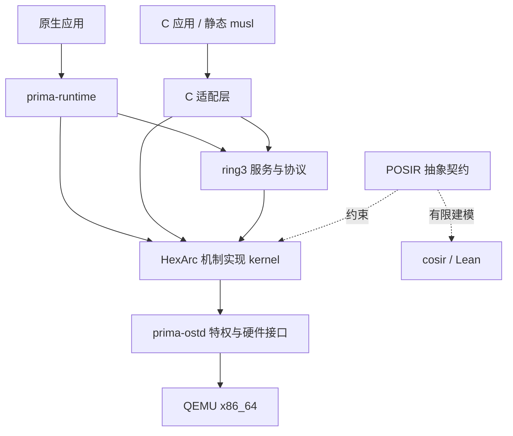

# 系统层次与源码地图

本页解释代码归属，架构约束以[白皮书](../../Prima%20OS.md)和[原语规范](../../COSIR%20原语规范.md)为准。实现进度只查[阶段跟踪](../../Prima%20OS%20实现阶段.md)。

## 从语义到机器

这是职责关系图。POSIR 是抽象语义层，COSIR 是具体硬件细化工作，不是两个串行执行的运行时进程。

## crate 与入口

| 模块 | 职责 | 先读源码 | 修改时关注 |
|---|---|---|---|
| cosir | 宿主可执行模型、抽象投影与细化设计实验 | [lib.rs](../../cosir/src/lib.rs)、[state.rs](../../cosir/src/state.rs)、[abstract_ops.rs](../../cosir/src/abstract_ops.rs) | 模型覆盖范围不等于完整内核 |
| kernel | 对象、授权、调度、syscall 与页表机制编排 | [main.rs](../../kernel/src/main.rs)、[bootstrap.rs](../../kernel/src/bootstrap.rs)、[syscall.rs](../../kernel/src/syscall.rs) | `kernel/src` 零 unsafe；容量与失败原子性 |
| prima-ostd | 唯一允许必要 privileged unsafe 的硬件框架 | [entry.rs](../../prima-ostd/src/entry.rs)、[arch.rs](../../prima-ostd/src/arch.rs)、[mm.rs](../../prima-ostd/src/mm.rs)、[sync.rs](../../prima-ostd/src/sync.rs)、[IRQ 锁](../../prima-ostd/src/sync/lock.rs)、[align.rs](../../prima-ostd/src/align.rs) | 每个硬件操作的安全不变量 |
| prima-abi | 原生号段、boot manifest、boot info、trace 布局 | [lib.rs](../../prima-abi/src/lib.rs) | 实验性 ABI，号段只追加、不复用空洞 |
| prima-runtime | 原生 safe API、传输抽象、服务协议与 VFS 辅助 | [lib.rs](../../prima-runtime/src/lib.rs)、[transport.rs](../../prima-runtime/src/transport.rs)、[protocol.rs](../../prima-runtime/src/protocol.rs) | 包装检查不替代内核授权 |
| prima-user | ring3 服务、驱动、应用；C 适配与 musl 补丁 | [servicemgr.rs](../../prima-user/src/servicemgr.rs)、[prima_syscall.c](../../prima-user/c/prima_syscall.c) | 原生/兼容语义、按 Task 授权和探针边界 |
| prima-initgen | 构造 init 可执行输入与原生调用编码 | [lib.rs](../../prima-initgen/src/lib.rs)、[code.rs](../../prima-initgen/src/code.rs) | 与 boot ABI 保持一致 |
| xtask | 镜像打包、QEMU 见证、差分与门禁 | [main.rs](../../xtask/src/main.rs)、[image.rs](../../xtask/src/image.rs)、[protocol.rs](../../xtask/src/protocol.rs) | 预期 trace 与负例不能随意放宽 |
| lean | 独立 Lean 状态、CDT 不变量与证明 | [README](../../lean/README.md)、[Formal.lean](../../lean/Formal.lean) | 保留映照契约与 cosir-only 差异 |

## 启动路径

`cargo xtask build` 经 `xtask/image.rs` 构建 BIOS/UEFI 镜像并打包 ramdisk。manifest 格式定义在 `prima-abi::boot_image`，启动信息在 `prima-abi::boot_abi`；内核按 init 的保留 kind 找到启动镜像，其他服务角色由 ring3 管理器解释。

后续 init/管理器建立服务与应用，服务间通过原生 IPC/共享 Segment 交互。历史 EXO 解耦过程见[启动主题](topics/boot.md)与[运行时主题](topics/runtime.md)。生成镜像、musl 工作副本与下载快照位于 `target/`，不属于源码文档。

## 调用与错误路径

原生调用：应用 → `Runtime`/`SyscallTransport` → 共享 ABI → 内核分派 → 授权/对象迁移 → 硬件框架 → 返回值。C 调用：musl → 补丁/`prima_syscall.c` → 原生机制或 ring3 服务 → C errno/返回值。Linux 风格号不能直接当成 Prima 号。

IPC、文件、网络等语义可跨多次调用；一次 syscall 成功不代表完整 POSIX 操作满足。fork 子任务的 VFS 授权限制就是跨层边界，见[进程主题](topics/process.md)。

## 改动影响检查

| 改动点 | 关联更新 |
|---|---|
| 原语前置/错误/状态迁移 | COSIR 规范、模型、内核、设计、测试与证据 |
| 机器入口/页表/中断 | kernel + prima-ostd + 细化边界 + host/QEMU |
| syscall 编号/布局 | prima-abi + 分派 + 原生封装 + C 适配/补丁 + trace |
| ring3 协议 | runtime 协议 + 服务/管理器 + 调用端 + QEMU 校验 |
| 兼容 API | profile/台账 + symbol-trace + C 探针 + Linux 参考范围 |
| 状态/退出证据 | 阶段跟踪 + 报告 + 主题阅读链 |

跨项目复用的锁定来源与许可证见[Asterinas 来源登记](asterinas-provenance.md)，适用边界与执行证据见[移植契约](../superpowers/specs/2026-10-24-asterinas-reuse-design.md)。
