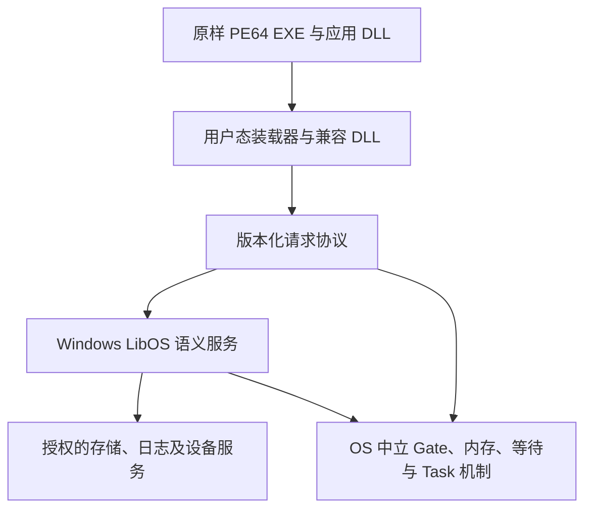

# Windows LibOS 计划书：PE64 控制台与服务兼容路径

## 1. 目标、性质与范围

作者在 2026-10-31 要求另写 Windows LibOS 计划书，并明确选择首轮目标为
“控制台与服务优先：PE64、DLL、文件、进程/线程、同步与异常”。本文将该目标拆成可评审的
技术路线、前置条件、工作包及验收门。**目标方向已确认，其余路线、API 集、预算和里程碑
为提案，尚未冻结，也未启动实现。**

本计划是独立的 personality 扩展候选。它不替换
[阶段 7 已确认的 Linux + Prima 原生/POSIX 组合](../specs/2026-10-31-stage7-scope-decisions.md)，
不自动成为阶段 7 的第三个必交付 personality，不指定新的阶段编号或排期。
整体进度与启动仍以[阶段跟踪](../../../Prima%20OS%20实现阶段.md)为准。

首轮建议范围：

- QEMU x86_64，PE32+ AMD64 控制台 EXE 和 DLL；先单线程见证，再扩至进程/线程与并发。
- 冻结的 Win32 API 与 DLL 导出集，覆盖控制台、文件、内存、进程/线程、同步、TLS、异常及最小服务控制。
- 同一份 Windows 目标程序在参考 Windows 与 Prima 中运行，应用 EXE 和应用 DLL 字节保持一致；
  Prima 提供自己的兼容 DLL、加载器与用户态服务，分别登记其身份。
- 与 Linux、Prima 原生/POSIX 域并存的授权与故障隔离，以及新增关键状态机的模型/实现证据。

首轮不包含 GUI/GDI/DirectX、COM/OLE、.NET、WOW64/32 位、ARM64 Windows、Windows 驱动
二进制、完整 NT 内核 ABI、任意第三方系统 DLL、完整注册表/ACL/域身份或完整 SCM。
Winsock、IOCP、重叠 I/O 和复杂运行时扩展按实际程序闭包另开切片，不能用成功空实现冒充支持。
后台服务运行与完整 Windows 系统服务生态分别描述。

## 2. 基线与现有证据链

代码基线为 `112c468988372f45557f2c1d36ac912ee76a1170`；写作工作树还包含同日已确认、
尚未提交的阶段 7 范围文档。以下是读取代码和报告得到的依赖判断，本次没有执行 Windows 程序。

| 可复用基线 | 本计划仍需验证的缺口 |
|---|---|
| [ELF 装载与初始栈代码](../../../kernel/src/exec.rs) | 不能作为 PE 装载器使用；需用户态 PE 解析、DLL 生命周期和独立 Windows 初始环境 |
| [Gate 入口台账](../compat/stage6-gate-native-abi.md)：73/74/77/78 已接线 | 75/76 代理复制尚未完成；六参数传输与只写 `rax` 不等于 NT syscall ABI |
| [当前 Gate 实现](../../../kernel/src/gate.rs) | `gate_client_root_is_exclusive` 拒绝多线程共享地址空间客户端；不能直接用于 Win32 多线程 |
| [线程基址保存](../../../kernel/src/sched.rs)、[MSR 支持](../../../kernel/src/msr.rs) | 现有 FS 保存不能替代 x64 Windows TLS 所需的用户 GS 上下文及其安全切换审查 |
| [阶段 5 签署](../reports/2026-10-27-stage5-exit-signoff.md)中的 Process/Task、共享能力视图和有界 POSIX profile | 不等于 Windows 进程句柄、继承、线程终止、TEB、APC 或 NT 访问权已兼容 |
| [通用等待等候选采纳审核](../reports/2026-10-14-cosir-dual-personality-adoption-review.md) | 规范采纳不等于实际实现覆盖 Windows 的消费型同步对象、多对象原子等待和可警报等待 |
| [VFS/LibOS 基础](../specs/2026-10-23-vfs-libos-foundation-design.md)与后继证据 | Windows 路径、大小写、共享打开、删除/重命名、字节锁和文件映射需要独立语义 |

历史链必须一起阅读：
[双人格差距分析](../reports/2026-10-14-cosir-dual-personality-gap-analysis.md) →
[候选采纳审核](../reports/2026-10-14-cosir-dual-personality-adoption-review.md) →
[Holder 草案](../specs/2026-10-14-dual-personality-holder-model-design.md) →
[H0 条件评审](../reports/2026-10-14-dual-personality-holder-model-h0-review.md) →
阶段 5 Process/Thread 的后继实现与签署。

早期“没有进程/线程”的描述属于当时基线；H0 条件通过也不能被当作完整 holder 重构已经落地。
WIN-M0 须重新核对实际持有者、共享视图、根与地址空间身份，复用已存在能力；仅在发现具体
无法表达的组合时提出最小中立修订，不先重做一套 Process/Thread 框架。

## 3. 兼容层级与建议路线

### 3.1 三种不同主张

| 层级 | 含义 | 本计划的处理 |
|---|---|---|
| Windows 源码兼容 | 为 Prima 修改/重新编译应用并替换其平台接口 | 可用作开发手段，不作为“原样 Windows 二进制运行”的退出证据 |
| PE64 / Win32 导入兼容 | 原样 Windows 目标 EXE/应用 DLL，经兼容 DLL 实现冻结 API | 建议作为 v1 主线 |
| Windows Native NT ABI | 原样系统 `ntdll`、直接 NT syscall 及其版本相关环境 | 不在 v1 承诺；如后续需要，独立冻结参考版本、陷入帧和参数布局 |

Windows x64 函数调用的寄存器、栈参数、shadow space 与非易失状态有独立约定；不能把
Prima 的六参数 syscall 约定用作函数 ABI。[Microsoft x64 calling convention](https://learn.microsoft.com/en-us/cpp/build/x64-calling-convention?view=msvc-170)

例如 `NtCreateFile` 有 11 个形参，足以说明“复制六个寄存器”不是完整的 Windows 原生调用
适配方案；本文不据此推断其机器 syscall 号或布局。[Microsoft NtCreateFile](https://learn.microsoft.com/en-us/windows/win32/api/winternl/nf-winternl-ntcreatefile)

### 3.2 推荐：兼容 DLL + 私有语义服务 + 通用受保护传输

兼容 DLL 导出 Windows 函数 ABI，在调用方用户态完成参数编解码，再通过版本化请求块发送
LibOS 操作。多于六个形参、嵌套结构和可变长 UTF-16 字符串采用明确布局与长度，不能截断。
纯局部操作可以在 DLL 中完成；共享句柄、对象生命周期及 I/O 状态由域内语义服务协调。

请求者不因加载兼容 DLL 获得原生控制能力。若使用 Gate，应用发出的全部陷入继续先进入
受保护传输，只有授权服务能进行原生资源操作。传输号是项目自有协议，不能伪称 Windows
NT syscall 号；未知操作按版本化协议失败并审计，不能回落为原生内核调用。
直接 NT syscall 不属于白名单保证，不声称能仅凭静态扫描自动识别所有直接调用。

PE/DLL 装载、Win32 `HANDLE`、NTSTATUS/Win32 错误转换、文件共享模式、同步对象及服务
管理都留在用户态。硬件上下文、跨地址空间复制、等待和授权变更若需内核支持，按既有
OS 中立契约评审，不向内核添加 `NtCreateFile`、Windows 文件对象或 Windows 专属分派。

### 3.3 复用路线比较

| 路线 | 收益 | 主要代价与选择门 |
|---|---|---|
| 小型兼容 DLL 与语义服务 | 能按白名单逐步验证与 Prima 能力边界的映射 | 首轮建议；必须用真实 Windows 差分约束语义，不能靠自测互相印证 |
| 复用 Wine 的选定 DLL/运行时实现 | 可能减少成熟 Win32 语义的重写 | 先评估具体源码、工具链、宿主依赖和授权接口，再决定；不预先移植整套 Wine |
| 完整 Wine 宿主适配 | 后续可能扩大应用覆盖 | 单独成本与依赖评审，不是完成 PE 装载后即可免费获得的能力 |
| 直接复用 Windows 系统 DLL/NT syscall | 表面上接近现有环境 | 内部依赖与版本范围显著不同，不选为 v1 默认路径 |

Wine 自身由程序装载器和 Windows API 实现组成，并有明确的宿主环境要求，因此其适配需
作为独立工程评估。[Wine 项目 README](https://github.com/wine-mirror/wine/blob/master/README.md)
本计划不引入第三方代码；若后续复用，先锁定版本/提交、来源、构建与 NOTICE，再按
[仓库许可规则](../../architecture/licensing.md)登记。参考 Windows 镜像与 SDK 不随仓库提交。

## 4. 候选 profile v1

以下均为**拟支持范围，当前未实现、未冻结**。WIN-M0 根据程序完整导入闭包、CRT 依赖和
运行轨迹决定精确符号、标志、结构版本及限制；超出范围的调用不得一律返回成功。

| 子集 | 候选 API / 行为 | 必须冻结或验证的边界 |
|---|---|---|
| PE 与 DLL | PE32+ AMD64、映像映射、重定位、导入/导出、按名/序号查找、转发导出；`LoadLibraryW`/`GetProcAddress`/`FreeLibrary` | 越界/溢出、节重叠、RVA 与文件偏移、失败回滚、DLL 引用与初始化顺序；delay import 按白名单决定 |
| DLL 契约 | 白名单涉及的 `kernel32`、`kernelbase`、`ntdll`、CRT、`advapi32` 导出与 API-set 路由 | 名称集合不是完整 DLL 实现；CRT 型号、API-set 与动态探测路径必须完整登记 |
| 启动与局部状态 | 命令行、环境、工作目录、标准句柄、`GetLastError`/`SetLastError` | 命令行解析属于相应运行时；错误值按线程维护，不把所有原生 errno 直接改名 |
| 内存与堆 | `VirtualAlloc`/`VirtualFree`/`VirtualProtect`/`VirtualQuery`、白名单堆接口 | reserve/commit/decommit/release、粒度、清零、权限与 W^X；非法组合明确失败 |
| 文件与控制台 | `CreateFileW`、同步 `ReadFile`/`WriteFile`、seek、元数据、枚举、删除/重命名、标准 I/O | UTF-16 路径、根/盘符映射、大小写、共享打开和删除规则；锁及文件映射按应用闭包纳入 |
| 句柄 | `CloseHandle`、`DuplicateHandle`、继承标记、进程/线程伪句柄 | 类型、访问权、进程局部表、引用计数和失效；原始数值不能授权另一域 |
| 进程与线程 | `CreateProcessW`、`CreateThread`、退出/终止、退出码、等待 | 共享地址空间及表、显式继承、主线程与进程生命周期、悬挂创建/恢复是否支持须逐 flag 定义 |
| TLS | 静态 TLS、TLS callbacks、动态 `Tls*`、TEB/PEB 最小所需状态 | 用户 GS 保存/恢复、每线程隔离、DLL 装载/卸载交错；不依赖未冻结的内部结构全布局 |
| 同步 | 事件、信号量、mutex、critical section；单对象和多对象等待、超时 | auto/manual reset、递归/所有者、abandonment、WaitAny 选择、WaitAll 原子消费、销毁交错 |
| 异步通知 | 白名单所需 `QueueUserAPC` 和可警报等待 | 指定线程、投递时机、返回码及回调上下文；不把 POSIX signal 直接视作 APC |
| 异常 | 软件异常、访问故障递送、x64 表驱动展开与冻结的 SEH 路径 | 全寄存器上下文、非易失状态、异常嵌套和终止；C++ EH/JIT/调试器接口初期不默认覆盖 |
| 服务 | 最小 SCM 适配与 `ServiceMain`、控制回调、状态上报；启动/停止/查询 | 先冻结有限自有进程服务；由 Prima 管理器监督，服务账号、依赖组和完整注册表另议 |

PE 中导入、重定位及静态 TLS 是不同装载责任，不能只识别 `MZ/PE` 后跳到入口。
[Microsoft PE Format](https://learn.microsoft.com/en-us/windows/win32/debug/pe-format)
API-set 名表示契约并由装载器路由，不能简单按同名磁盘文件查找。
[Microsoft Windows API sets](https://learn.microsoft.com/en-us/windows/win32/apiindex/windows-apisets)

`DllMain` 有装载期约束，需验证回调和初始化失败；不能为了消除死锁任意改为不调用。
[Microsoft DllMain](https://learn.microsoft.com/en-us/windows/win32/dlls/dllmain)
TEB 的公开定义本身有版本变化说明，v1 只能承诺其冻结范围。
[Microsoft TEB](https://learn.microsoft.com/en-us/windows/win32/api/winternl/ns-winternl-teb)

## 5. 关键技术门与反例

### 5.1 用户态 PE 装载与发布

复用受保护内存和 Task 机制，在用户态完成解析、映射计划、重定位、DLL 解析及初始环境。
需验证可信加载器能在目标尚未运行时构造地址空间、栈、TEB/PEB 并最终发布入口；当前原生
ELF exec 不直接承担 PE 语义。若缺少受控停车或发布能力，先提出通用机制设计。

目标程序不得在部分 IAT、可写代码页或未初始化 TLS 状态下开始执行。支持的 PE 必须通过
完整边界检查；只读/可执行权限在发布前落实。不能靠永久 W+X 映射或忽略未知关键目录换取启动。

### 5.2 多线程与跨任务参数

Gate 当前的独占地址空间限制是硬依赖。Windows 多线程需要重新评审绑定身份、Process/root
代次、映射变化、COW、并发访问与请求寿命；不能仅移除准入检查。一次复制的原子性不自动
保证多个指针组成的整个 API 事务一致；复杂参数应先复制/验证到服务者的稳定快照。

先定义 `HANDLE → 域内对象/访问权 → Capability/服务会话` 映射，复用生产共享能力视图。
关闭一个 Windows 句柄只影响相应引用；不能把任意 Windows 句柄数值直接当原生 Capability，
也不能为每次复制句柄都错误地复制底层文件游标。

### 5.3 同步原子性与 APC

WaitAll 需要在同一逻辑提交中满足条件和消费同步状态；不能逐个占有部分对象后阻塞。
Windows 对多对象等待的选择和状态修改有具体约束。
[Microsoft WaitForMultipleObjects](https://learn.microsoft.com/en-us/windows/win32/api/synchapi/nf-synchapi-waitformultipleobjects)

建议先在域内协调服务定义同步对象状态机，借助通用 WaitObject 的 generation/登记机制
完成检查与休眠的交接，并证明无丢唤醒；不把 generation 的 WaitAll 当作全部 Windows
消费语义已经满足。若这一组合无法安全实现，记录反例并评审最小中立协作机制。

Gate v1 的不可警报等待和仅 `rax` 答复也不能直接表达用户 APC 回调。需要独立的安全上下文
保存、投递和恢复协议；Windows APC/SEH 不借用未经验证的 Linux 信号布局。

### 5.4 文件、异常与服务

Windows 共享打开模式会限制后续打开/删除操作，不能直接继承 POSIX unlink-open 结果。
[Microsoft CreateFileW](https://learn.microsoft.com/en-us/windows/win32/api/fileapi/nf-fileapi-createfilew)
大小写和 Unicode 规则应显式冻结，不能用 ASCII 小写转换宣称完整 Windows 路径兼容。

x64 异常展开依赖函数展开信息；需要解析并验证相关元数据，不能以返回一个错误码代替
SEH 执行。[Microsoft x64 exception handling](https://learn.microsoft.com/en-us/cpp/build/exception-handling-x64?view=msvc-170)
参考服务程序也有主函数、`ServiceMain` 与控制处理器等独立职责，后台循环存活不是完整服务
控制验收。[Microsoft Service Program Tasks](https://learn.microsoft.com/en-us/windows/win32/services/service-program-tasks)

## 6. 工作包、依赖与预期验收

工作包使用独立 `WIN-M*` 命名，不与现有 QEMU `W1/W2/…` 用例编号混用。以下全部是计划观察。

| 包 | 依赖 | 工作与候选负责路径 | 预期验收与停止门 |
|---|---|---|---|
| WIN-M0 范围与基线 | 本计划评审 | 固定 Windows 参考 build/架构、SDK/工具链、程序/CRT/DLL 闭包、API 行和来源；审计当前 holder 模型 | 每项 API 有文档、期望、限制及参考用例；缺参考 Windows 时差分保持未完成，不用 Wine 代签 |
| WIN-M1 PE/ABI 模型 | M0 | 拟建用户态兼容组件中的 PE 纯解析、映射计划和 Win64 ABI 小探针；先 host 测试 | 坏 PE、RVA 溢出、重定位/导入/TLS 负例；四寄存器及栈参数、shadow space、非易失与浮点状态对拍 |
| WIN-M2 受保护启动原型 | M1、通用加载/内存支持 | 用户态装载器和最小 DLL，经 `prima-runtime` 使用现有映射/Task 机制；必要中立扩展先评审 | ring3 原样 PE64 调用替代导出、输出并退出；另一域继续运行；发布失败无残留可执行映射 |
| WIN-M3 DLL/运行时基础 | M2、参数复制与用户 GS 设计 | 拟建兼容 DLL/语义服务：加载、API-set、TEB/PEB、TLS、堆、错误、命令行与环境 | 双 DLL、静态/动态 TLS、回调顺序、动态查找及卸载负例；返回值与线程错误不串扰 |
| WIN-M4 文件与句柄 | M3、授权服务协议 | 兼容层访问通用 VFS/控制台；实现域内句柄表和文件共享策略 | 两打开共享/冲突、重复/关闭/继承、删除与重命名、UTF-16 路径、越权和部分 I/O；对端文件内容核对 |
| WIN-M5 进程/线程 | M3、holder 复核、共享 root 的受控传输与复制 | 复用 `bootstrap`/调度的 Process/Task 能力；新增通用 GS 上下文按需放 `prima-ostd` | 同进程句柄/TLS/地址空间共享与隔离、子进程继承、退出/终止、等待/退出码；多线程陷入无错绑 |
| WIN-M6 同步/APC | M5、通用等待/上下文协议 | 域内同步协调及回调分派，host 状态机与调度交错测试 | auto/manual event、semaphore、递归/abandoned mutex、WaitAny/All、超时与 APC 竞争；无部分消费、无丢唤醒 |
| WIN-M7 SEH | M3/M5、异常上下文评审 | 用户态展开器和异常分派，复用经验证的通用异常递送/恢复 | 软件异常与访问故障的处理、继续/展开/终止；非易失状态、栈界、坏展开表及嵌套负例 |
| WIN-M8 控制台服务闭环 | M4–M7 的所需 API | 最小服务控制适配，接入 `prima-user` 现有服务管理职责 | 同一 PE 服务在 Windows 与 Prima 完成注册/启动/状态/停止及文件作业；控制拒绝与崩溃清理可审计 |
| WIN-M9 并存与硬化 | M4–M8、相应阶段 7 机制 | 按需接入配额、撤销、监督与端到端恢复；新增模型与生产映照 | Windows/Linux/原生域并存；无授权不能互访；资源耗尽/撤销/组件故障矩阵有界通过；明确恢复协议覆盖 |
| WIN-M10 冻结与签署 | M0–M9 | Windows profile、符号追溯、制品清单、报告、验收工具与文档索引 | 原样真实 CLI 与服务、逐 API 差分、负例、成本与关键性质证明形成完整包；独立评审后签署 |

建议只在 M0 的目录/构建设计通过后，创建例如 `prima-windows/` 的最小用户态组件；这是候选
归属，不是已经存在的源码路径。本次不创建 crate、空接口或预留 syscall 号。
通用改动沿用 `prima-runtime`、`prima-abi`、`kernel`、`prima-ostd` 现有边界，保持内核零 unsafe。

## 7. 程序白名单与差分证据

建议先用小型 Windows 目标探针隔离问题，再加入至少一个独立开源 CLI 和一个实际服务样例。
自写探针可以验证 ABI，但不能单独支撑“真实 Windows 应用兼容”的结论。

| 输入类别 | 计划覆盖 |
|---|---|
| 装载/调用探针 | 按名/序号导入、转发、重定位、缺 DLL/符号、七个以上形参、浮点/非易失状态 |
| 运行时探针 | 命令行/环境/Unicode、TLS callbacks、动态装载、线程错误、分配释放 |
| 文件/句柄探针 | 共享打开冲突、文件游标、删除/重命名、继承/重复句柄、标准 I/O |
| 并发/异常探针 | CreateProcess/CreateThread、WaitAll、abandonment、APC、SEH 与故障清理 |
| 独立真实 CLI | 从公开 Windows x64 制品中选定一个；SQLite CLI 可作为存储工作负载候选，须先审计完整导入和运行依赖 |
| 服务样例 | 固定源码/工具链编译的 Windows 服务 PE，处理可核对的文件作业，使用冻结的服务控制接口 |

SQLite 的 CLI 与链接到程序的 SQLite 库是不同验证对象；这里只提议评估 CLI，尚未选择版本、
制品或宣称能够运行。[SQLite CLI 官方说明](https://sqlite.org/cli.html)

同一探针可交叉编译为 Windows 目标，但必须先在真实 Windows 参考运行，并以同一 EXE/DLL
字节在 Prima 重跑；不能链接 Prima 私有接口后仍称原样 Windows 应用。记录源码、编译器、
CRT、所有 DLL、PE 属性与 SHA-256。Windows build/修订号、语言、区域、时区、文件系统、
权限、CPU 及服务配置也需固定，不能用版本可变的系统 DLL 作隐含基线。

比较返回值、错误、输出缓冲、句柄关系、阻塞/唤醒、文件及服务状态。地址、PID 和时间等
非确定字段通过预先定义的关系比较，不能为了通过任意删除差异。参考 Windows 环境尚未准备，
本计划未取得任何 Windows 差分结果；Wine 可作辅助对照，不能替代所选 Windows 参考。

未来可在 `xtask` 增加独立 Windows 构建/验收入口，命令名及制品获取规则在 M0 冻结；
当前没有 `cargo xtask test-windows`，本文不将其列为可执行命令。
实际代码变更仍需 workspace 测试、lint、适用 QEMU 回归与 Windows 逐 API 差分；证明和运行证据分别归档。

## 8. 隔离、恢复与形式化义务

Windows 句柄表、模块状态、对象命名及根视图按实例隔离。共享日志/存储等服务只通过显式
Capability 和版本协议访问；Windows 访问权不能扩大底层 Authority。窗口、文件或 NT 对象
不能为了性能进入可信机制层。

若复用阶段 7 的配额、完整撤销和透明恢复机制，应提供 Windows API 到这些机制的映照，
不能从 Linux/POSIX 验收直接推出 Windows 已覆盖。恢复只对明确冻结的端到端请求及故障模型
给出承诺；本计划不把任意第三方 Windows 程序的透明恢复作为免费能力。

新增模型至少覆盖句柄授权不扩大、旧句柄不复活、共享表引用守恒、WaitAll 原子消费、
等待登记/完成一致性，以及所选恢复协议的去重和状态一致性。用户态模型、通用内核模型及
生产实现映照分别给范围，既有 Lean 句柄证明不能代替所有上述性质。

性能先测 PE/DLL 启动、局部 API、服务请求往返、文件 I/O、等待唤醒和异常处理成本，
拆开装载、编解码、复制、调度与审计开销。正式门槛在基线后确认；QEMU 数据不外推实机。

## 9. 冻结门、预算与停止条件

实现前至少明确：

| 冻结门 | 待决定内容 |
|---|---|
| WIN-D1 版本/profile | Windows 参考 build、编译器/CRT、DLL/API-set、应用/服务白名单及每行语义 |
| WIN-D2 复用 | 自有薄层与选定 Wine 代码的边界、工具链、来源与接口；不默认移植整套 Wine |
| WIN-D3 装载/GS | 停车与发布、映射权限、PE 初始化、用户 GS 与内核/per-CPU 上下文的安全分离 |
| WIN-D4 共享与复制 | 共享 root 下 Gate 绑定、对象代次、双端权限、并发参数快照、取消/销毁和失败原子性 |
| WIN-D5 同步/异常 | WaitAll/abandonment/APC/SEH 状态机、上下文与展开格式、对应证明和反例 |
| WIN-D6 文件/服务 | 路径/共享/删除/锁语义、最小 SCM、错误映射、未知标志及能力授权 |
| WIN-D7 硬化/签署 | 资源预算、撤销/恢复协议、性能门槛、形式化映照、阶段归属与独立退出签署 |

建议第一预算包只覆盖 M0–M2 的有界探索，工作量上限由启动评审确认；本次没有作者确认的
人周或日历承诺。通过真实 PE/Gate/GS 原型后，再按 DLL/CRT 闭包、并发和异常缺口估算后续成本，
不沿用阶段 6–7 的旧估算，也不按导出函数数量推算兼容完成度。

停止或重审触发：

- 必须让内核识别 NT syscall/文件/同步对象才能保持白名单语义，记录为 H1/H3 反例并评审。
- 只能修改应用 EXE、绕过 Capability、保留永久 W+X 或取消审计才能运行，不能继续宣称原样兼容。
- Gate 共享 root、GS 或异常上下文仍不安全时，暂停相应多线程/APC/SEH 里程碑，不删检查强行接线。
- 选定应用引入 GUI、COM、完整注册表、异步 I/O 等未定义依赖时，重新评审白名单/profile，不能只补成功桩。
- 缺少 Windows 参考、证明或关键故障窗口证据时，保持未验收；不能用主机单测或其它 personality 的 PASS 覆盖。

## 10. 收口、文档验证与生命周期

执行时依次产出明确适用的设计规格、Windows profile、程序/DLL 身份台账、符号到机制/服务
追溯、分层测试/差分报告及独立签署。每次更新阶段跟踪与证据索引；本计划保留当时拆分，
不维护第二份当前进度表，完成后可转 historical。

本次只编写计划和导航，不新增 Rust、PE 制品、运行结果或证明，不修改已确认的阶段 7 范围。
所有原始运行输出留在 `/tmp/` 或 ignored `target/`，仅在所属 Markdown 报告内嵌必要结果，
不提交独立日志或哈希附件。本次纯文档整理的检查结果如下：

| 命令 | 结果与范围 |
|---|---|
| `python3 scripts/docs.py self-test` | PASS：文档解析、检索、确定性、生命周期和变更守卫 |
| `python3 scripts/docs.py build` | PASS：355份文档的目录由脚本生成 |
| `python3 scripts/docs.py check` | PASS：目录、身份、主题路由、本地链接与锚点 |
| `python3 scripts/docs.py check --base 112c468` | PASS：相对本轮提交前基线的新文档与恢复守卫 |
| `git diff --check` | PASS：空白检查 |

上述检查不构成 PE64、Win32、Windows 参考差分或形式化证明的实现证据。
